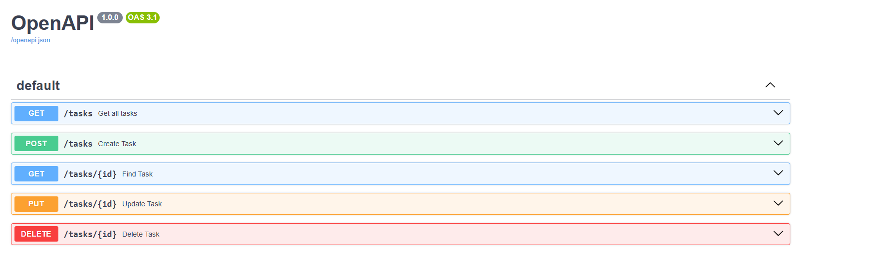

# Tehtävä REST API - Opiskelijan harjoitustyö

## Projektirakenne

1. URL reititykset sijaitsevat tiedostossa `src/index.ts`.
2. Tasks API rajapinnan toteutukset ovat kansiossa `src/endpoints/tasks/`.
3. Tehtäväskeemat on määritelty tiedostossa `src/endpoints/tasks/base.ts`.
4. Integraatiotestit löytyvät `tests/` kansiosta.
5. Lisätietoja löytyy [chanfana-dokumentaatiosta](https://chanfana.com/), [Hono-dokumentaatiosta](https://hono.dev/docs) ja [Vitest-dokumentaatiosta](https://vitest.dev/guide/).


```
project/
├── src/
│   ├── index.ts
│   └── routes/
│       └── taskCreate.ts
│       └── taskDelete.ts
│       └── taskList.ts
│       └── taskRead.ts
│       └── taskUpdate.ts
├── package.json
└── tsconfig.json
```



<!-- dash-content-start -->

Tämä on OpenAPI dokumentaatio, joka on rakennettu **Cloudflare Workerien** avulla ja sisältää **Tehtävien hallinnan REST API:n** OpenAPI 3.1 -automaattisella generoinnilla ja validoinnilla käyttäen [chanfana](https://github.com/cloudflare/chanfana) ja [Hono](https://github.com/honojs/hono) kirjastoja.

Tehtäväsi on toteuttaa API-päätepisteiden funktiot, jotka vastaavat pyyntöihin tehtävien hallinnassa. OpenAPI-skeema generoidaan automaattisesti koodistasi, ja kaikki sisääntulevat pyynnöt validoidaan määriteltyjen parametrien ja request body -skeemojen mukaisesti. Voit testata toteutuksiasi suoraan OpenAPI:n interaktiivisen dokumentaation kautta.

Projekti sisältää esimerkkipäätepisterakenteita ja integraatiotestejä [Vitest](https://vitest.dev/) avulla, jotka auttavat sinua toteutuksessa. Tehtäväsi on täydentää päätepisteiden käsittelijät kansiossa `src/endpoints/tasks/` siten, että voit luoda, lukea, päivittää ja poistaa tehtäviä OpenAPI-skeemaa noudattaen. Tiedot tallennetaan muistissa tämän harjoituksen ajaksi.


## Asennusohjeet

1. Asenna projektin riippuvuudet valitsemallasi paketinhallinnalla:

```bash
npm install
```

Selvä! Tässä uusi kohta, joka kannattaa lisätä harjoitustyöhön ohjeistamaan opiskelijaa tutustumaan Cloudflare Workersin KV-template-projektiin ennen varsinaista tehtävää:

---

## Tehtävä 0: Tutustu KV-tutoriaali templateen (tätä käydään myös tunnilla)

Ennen kuin aloitat tehtävän tekemisen, on hyvä tutustua Cloudflare Workersin KV Storeen templaten avulla. Tämä antaa peruskäsityksen KV Storen käytöstä ja miten dataa voidaan tallentaa pysyvästi Workerissa. Ohje löytyy myös [Cloudflaren sivuilla](https://developers.cloudflare.com/kv/get-started).

1. Luo uusi projekti KV-tutoriaali templatea käyttäen:

```bash
npm create cloudflare@latest -- --template=kv-tutorial
```

2. Siirry projektihakemistoon ja asenna riippuvuudet:

```bash
cd kv-tutorial
npm install
```

3. Käy läpi template-projektin rakenne:

   * `index.ts` – entrypoint Workerille
   * KV-get ja KV-put funktiot – esimerkit, miten data tallennetaan ja haetaan

4. Aja paikallisesti:

```bash
npm run dev
```

5. Kun olet tutustunut templateen, voit siirtyä luomaan oman projektisi käyttäen OpenAPI-templatea ja injektoitua KV Storea harjoitustyössä.

---

Tämän avulla saat hyvän katsaukseen KV Store -logiikkaan ennen kuin alkaa kirjoittaa `storage.ts`-funktioita ja API-päätepisteitä.

Voit tarkastella generoituja OpenAPI-skeemoja selaimessa osoitteessa `/openapi.json` tai poimia ne paikallisesti komennolla:

```bash
npm run schema
```

<!-- dash-content-end -->
## Tehtävä 1: Toteuta Storage-funktiot

Luo tiedosto `src/endpoints/tasks/storage.ts` ja toteuta seuraavat funktiot:

```typescript
async function readAll() {
  // Toteuta tietojen lukeminen muistiin tai varastoon
}

export async function listTasks() {
  return readAll();
}

export async function getTask(id: number) {
  const tasks = await readAll();
  // Lisää logiikka yksittäisen tehtävän hakemiseksi ID:n perusteella
}
```

Näiden funktioiden avulla API:n päätepisteet voivat hakea ja käsitellä tehtävädataa.


## Tehtävä 2: Toteuta Tehtävä-API:n Päätepisteet

1. Täydennä seuraavat päätepisteiden funktiot kansiossa `src/endpoints/tasks/`:

* `taskList()` - Listaa kaikki tehtävät
* `taskCreate()` - Luo uusi tehtävä
* `taskRead()` - Hae yksittäinen tehtävä ID:n perusteella
* `taskUpdate()` - Päivitä tehtävä
* `taskDelete()` - Poista tehtävä

Jokaisen funktion tulee validoida pyynnöt OpenAPI-skeeman mukaisesti, joka on määritelty tiedostossa `src/endpoints/tasks/base.ts`. Tiedot pysyvät muistissa workerin sessiosta riippuen.

## Tehtävä 3: Muuta projektin nimeä

1. Aloita harjoitus muuttamalla projektin nimi haluamaksesi tiedostossa `wrangler.jsonc`. Tämä auttaa tunnistamaan projektisi Cloudflare Workers -ympäristössä.

2. Vie projekti käyttöön Cloudflaren palveluun (deploy):

```bash
npm run deploy
```

3. Seuraa workerin lokia:

```bash
npm run tail
```

## Testaus

Tämä malli sisältää integraatiotestit käyttäen [Vitest](https://vitest.dev/). Testien ajaminen ja toteutusten tarkistaminen:

```bash
npm run test
```

Testitiedostot löytyvät `tests/` kansiosta. Käytä niitä apuna varmistaaksesi, että päätepisteiden toteutukset toimivat oikein.


---

## Cloudflaren alkuperäinen template, johon harjoitus perustuu

Tämän repositorion ulkopuolella voit aloittaa uuden projektin käyttäen tätä mallia [C3](https://developers.cloudflare.com/pages/get-started/c3/) -työkalulla (`create-cloudflare` CLI):

```bash
npm create cloudflare@latest -- --template=cloudflare/templates/openapi-template
```

Mallin julkinen live-versio löytyy osoitteesta: [https://openapi-template.templates.workers.dev](https://openapi-template.templates.workers.dev)

Templaten voi laittaa omaan ympäristöön ajoon käyttämällä alla olevaa linkkiä:

[](https://deploy.workers.cloudflare.com/?url=https://github.com/cloudflare/templates/tree/main/chanfana-openapi-template)
